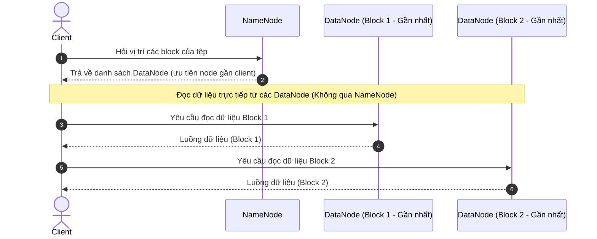
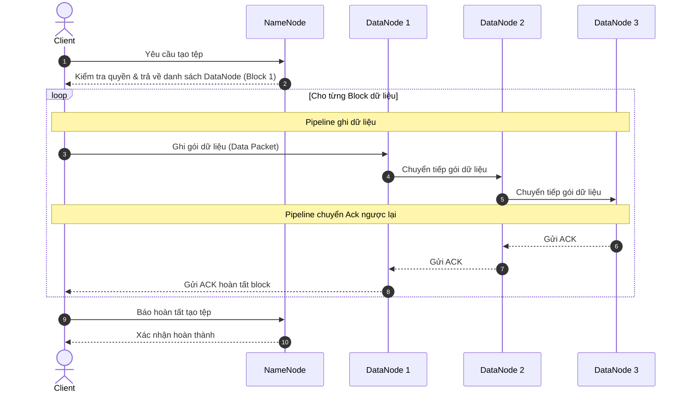

# Tổng quan

**HDFS** là hệ thống lưu trữ dữ liệu phân tán.

**Ý tưởng cốt lõi:**
- Chia tệp lớn thành nhiều **block** (mặc định 128 MB).
- Phân tán các block lên nhiều máy (**DataNode**).
- Sao chép (replicate) mỗi block ra nhiều máy (mặc định 3 bản) để chịu lỗi.
- Mô hình truy cập ghi một lần, đọc nhiều lần(**WORM** - write-once, read-many).
- Data locality: Bộ xử lý dữ liệu (MapReduce, Spark,...) có thể di chuyển thuật toán đến nơi lưu các khối lưu trữ để xử lý thay vì truyền dữ liệu qua mạng.

### Kiến trúc chính

HDFS hoạt động theo mô hình **Master-Slave** gồm các thành phần:
- **NameNode (master)**:
	- Lưu **metadata**: Cây thư mục, tên file, quyền truy cập, danh sách block của từng tệp, vị trí các block trên DataNode.
	- Mọi thay đổi của client trên HDFS đều phải thông qua NameNode.
	- Khi client thay đổi HDFS, NameNode ghi lại sự kiện đó (*transaction*) vào EditLog (lưu trên đĩa), cập nhật lên RAM rồi mới thông báo kết quả cho client.
	- **FsImage**: Là bản chụp (snapshot) toàn bộ namespace của hệ thống tệp tại một thời điểm *checkpoint* (thường là ngưỡng 1h hoặc 1000000 transaction), được xây dựng từ các block report do DataNode gửi lên.
	- **EditLog**: Là nhật ký ghi tuần tự mọi thay đổi xảy ra trên namespace sau thời điểm của FsImage gần nhất.

- **DataNode (slave)**:
	- Lưu các block dữ liệu thực trên đĩa cục bộ.
	- Gửi *heartbeat* (mặc định mỗi 3 giây) và *block report* định kỳ về NameNode.
	- Thực hiện đọc/ghi block theo yêu cầu của client hoặc NameNode.

- **Secondary NameNode / Checkpoint Node**:
	- Định kỳ gộp EditLog vào FsImage để tránh EditLog quá lớn.
	- Secondary NameNode không thay thế NameNode chính khi NameNode chính có vấn đề.

- **Standby NameNode (High Availability)**:
	- Là NameNode ở chế độ chờ, luôn đồng bộ dữ liệu với NameNode chính (*Active NameNode*) và nhận data report từ Data Node.
	- Có một tiến trình tên là *ZKFailoverController* (ZKFC) theo dõi trạng thái hoạt động các NameNode và quyết định xem NameNode nào sẽ active nếu gặp sự cố. Sự active của một NameNode được quyết định bởi tiến trình *ZooKeeper*.

- **Client**
	- Tương tác với NameNode để lấy metadata, sau đó đọc/ghi dữ liệu trực tiếp với DataNode.

**Cơ chế giải quyết sự cố**:
- **DataNode bị lỗi**: Dùng các DataNode nhân bản.
- **NameNode bị lỗi**: Không khắc phục được. Cho nên thực tế thường tạo nhiều NameNode.

### Quy trình hoạt động

**Client đọc dữ liệu**:


**Client ghi dữ liệu**:


>[!question] Vì sao HDFS không được thiết kế để cho phép client đọc data thông qua NameNode mà lại đọc trực tiếp từ DataNode?
>Nhằm giảm tải áp lực cho NameNode, đảm bảo sự phân tán của dữ liệu.

>[!question] Trong trường hợp 1 DataNode bị hỏng, client cần đọc dữ liệu từ DataNode nào?
>Từ DataNode gần nhất.

### Đặc tính cốt lõi

- **Fault Tolerance**: Dữ liệu được chia nhỏ thành các khối (*block*) khoảng vài trăm MB và tự động nhân bản sang nhiều máy tính khác nhau. Nếu một máy tính bị hỏng, dữ liệu cũng có thể được khôi phục.
- **WORM (Write-once, Read-many)**: Dữ liệu chỉ có thể được ghi một lần, sau đó chỉ có thể đọc hoặc bổ sung thêm.
- **Data locality**: Bộ xử lý dữ liệu (MapReduce, Spark,...) có thể di chuyển thuật toán đến nơi lưu các khối lưu trữ để xử lý thay vì truyền dữ liệu qua mạng.

# Một số thao tác cơ bản

### Thiết lập và khởi động HDFS

**Kích hoạt HDFS và YARN**
```sh
hadoop-3.5.0/sbin/start-dfs.sh
hadoop-3.5.0/sbin/start-yarn.sh
```

### Một số lệnh shell cơ bản

**Cú pháp chung:** Bạn có thể dùng `hdfs dfs -<lệnh>` hoặc `hadoop fs -<lệnh>`.
  
**`cat`**: Đọc và hiển thị nội dung file HDFS ra màn hình Terminal.
```sh
hdfs dfs -cat /path/to/hdfs/file.txt
```

**Tải dữ liệu TỪ Máy cục bộ (Local) LÊN HDFS**:
- `put` / `copyFromLocal`: Lệnh chuẩn.
- `moveFromLocal`: Copy từ Local lên HDFS **rồi xóa file gốc** ở Local.
```sh
hdfs dfs -put local_file.txt /DHQG-HCM/UIT/
hdfs dfs -copyFromLocal local_file.txt /DHQG-HCM/UEL/
hdfs dfs -moveFromLocal local_file.txt /DHQG-HCM/USSH/
```

**Tải dữ liệu TỪ HDFS VỀ Máy cục bộ (Local)**:
- `get` / `copyToLocal`: Lệnh chuẩn.
- `moveToLocal`: Lấy file về Local và xóa file trên HDFS (lưu ý: tùy phiên bản Hadoop tính năng này có thể bị hạn chế).
```sh
hdfs dfs -get /DHQG-HCM/UIT/local_file.txt ./
hdfs dfs -copyToLocal /DHQG-HCM/UIT/local_file.txt ./downloaded.txt
```

**Thao tác NỘI BỘ trên HDFS**:
- `cp`: Sao chép file/thư mục từ vị trí này sang vị trí khác **ngay trên HDFS**.
- `mv`: Di chuyển hoặc đổi tên file/thư mục **ngay trên HDFS**.
```sh
hdfs dfs -cp /DHQG-HCM/UIT/file.txt /DHQG-HN/CN/
hdfs dfs -mv /DHQG-HN/CN/file.txt /DHQG-HN/CN/file_renamed.txt
```

**Liệt kê và Xóa**:
- `ls`: Liệt kê nội dung thư mục. Dùng `-R` để xem đệ quy toàn bộ thư mục con.
- `rm`: Xóa file. Dùng `-r` hoặc `-rmr` để xóa đệ quy cả thư mục và các tệp bên trong.
- `count`: Đếm số lượng thư mục, tệp và dung lượng.
```sh
hdfs dfs -ls -R /DHQG-HCM
hdfs dfs -count /DHQG-HCM
hdfs dfs -rm -r /DHQG-HN/XD
```

### Biên dịch, Đóng gói và Chạy chương trình

Giả sử bạn có thư mục dự án gồm file source `WordCount2.java` (tham khảo source code tại [Example: WordCount_v2.0](https://hadoop.apache.org/docs/current/hadoop-mapreduce-client/hadoop-mapreduce-client-core/MapReduceTutorial.html#Example:_WordCount_v2.0)) đặt tại `~/wordcountv2/WordCount2.java`.

Truy cập file `hadoop-3.5.0/etc/hadoop/hadoop-env.sh` và thêm biến sau vào cuối file:
```sh
export HADOOP_CLASSPATH=${JAVA_HOME}/lib/tools.jar
```

Biên dịch file `.java` (tại `wordcountv2/WordCount2.java`) thành `.class` (tại `wordcountv2_compiled/`):
```sh
hadoop-3.5.0/bin/hadoop com.sun.tools.javac.Main -d wordcountv2_compiled wordcountv2/WordCount2.java
```

Đóng gói thành file `.jar`:
```sh
jar cvf wc.jar -C wordcountv2_compiled .
```

Tạo kho dữ liệu vào `input/`:
```sh
hadoop-3.5.0/bin/hdfs dfs -mkdir -p /input
hadoop-3.5.0/bin/hdfs dfs -put file.csv /input/
hadoop-3.5.0/bin/hdfs dfs -ls /input
```

Khởi chạy `.jar` và đưa dữ liệu vào `output/`:
```sh
hadoop-3.5.0/bin/hadoop jar WordCount2.jar WordCount2 /input /output
```

Xem kết quả:
```sh
hadoop-3.5.0/bin/hdfs dfs -ls /output
hadoop-3.5.0/bin/hdfs dfs -cat /output/part-r-00000 # Tùy thuộc vào file tên gì mà mở
```
