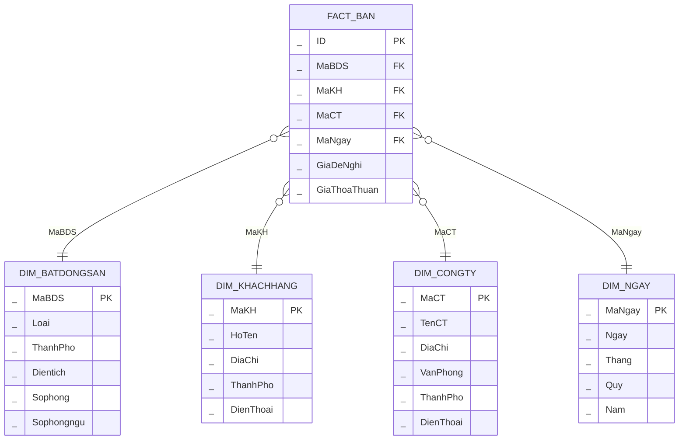

>[!note] Ràng buộc bài làm
>- Data warehouse chỉ có 1 fact.
>- Không cần đề xuất dữ liệu mẫu và kiểu dữ liệu cụ thể, tập trung vào thiết kế data warehouse và cú pháp MDX.

# Phần 1

1. A.
2. C.
3. C.
4. B.
5. C.

# Phần 2

## Thông tin kho dữ liệu



Tên kho dữ liệu: `DW_BDS`.

## Các độ đo đề xuất

1 - Tổng giá thỏa thuận:

```mdx
[Measures].[TongGiaThoaThuan] = SUM(FACT_BAN.GIATHOATHUAN)
```

2 - Số lượng giao dịch:

```mdx
[Measures].[SLGiaoDich] = COUNT(FACT_BAN.ID)
```

3 - Giá thỏa thuận trung bình:

```mdx
[Measures].[TBGiaThoaThuan] = IIF(
	[Measures].[SLGiaoDich] = 0,
	NULL,
	[Measures].[TongGiaThoaThuan] / [Measures].[SLGiaoDich]
)
```

## Các truy vấn đề xuất

1 - Top 5 giao dịch bất động sản có giá thỏa thuận cao nhất theo từng năm.

```mdx
SELECT
  [Measures].[Gia Thoa Thuan] ON COLUMNS,
  GENERATE(
    [Dim Ngay].[Nam].[Nam].MEMBERS,
    TOPCOUNT(
      [DIM_NGAY].[Nam].CURRENTMEMBER * [FACT_BAN].[ID].[ID].MEMBERS,
      5,
      [Measures].[Gia Thoa Thuan]
    )
  ) ON ROWS
FROM [DW_BDS]
```

2 - Drilldown từ năm đến quý để xem trung bình giá thỏa thuận.

Có cây phân cấp `[Nam - Thang]` như sau:
- . `Nam`.
- .. `Quy`.
- ... `Thang`.
- .... `Ngay`.

```mdx
SELECT
  [Measures].[TBGiaThoaThuan] ON COLUMNS,
  DRILLDOWNLEVEL([Dim Ngay].[Nam - Thang].[Nam].MEMBERS) ON ROWS
FROM [DW_BDS]
```

3 - Top 10 khách hàng có giao dịch với tổng giá thỏa thuận cao nhất trong giai đoạn 2017 - 2018.

```mdx
SELECT
  [Measures].[GiaThoaThuan] ON COLUMNS,
  TOPCOUNT(
    [DIM_KHACHHANG].[MaKH].[MaKH].MEMBERS * [DIM_KHACHHANG].[HoTen].[HoTen].MEMBERS,
    10,
    [Measures].[GiaThoaThuan]
  ) ON ROWS
FROM [DW_BDS]
WHERE ({ [DIM_NGAY].[Nam].&[2017] : [DIM_NGAY].[Nam].&[2018] } )
```
