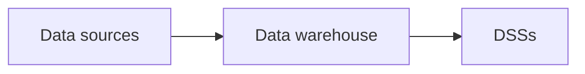
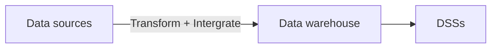
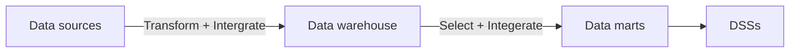

# Tổng quan về kho dữ liệu

### Hệ thống OLTP và OLAP

| Tiêu chí               | OLTP                                                      | Kho dữ liệu / OLAP                                                                 |
| ---------------------- | --------------------------------------------------------- | ---------------------------------------------------------------------------------- |
|                        | On-Line Transaction Processing.                           | On-Line Analytical Processing.                                                     |
| **Mục đích**           | Phục vụ các **hoạt động nghiệp vụ hằng ngày**.            | Phục vụ **phân tích và hỗ trợ ra quyết định**.                                     |
| **Loại dữ liệu**       | Dữ liệu phát sinh từ các hoạt động, giao dịch hằng ngày   | Dữ liệu được tổng hợp/tổ chức để phân tích, mang tính thông tin cao.               |
| **Tên gọi**            | Dữ liệu tác vụ (transactional data).                      | Dữ liệu phân tích (analytical data).                                               |
| **Hoạt động chính**    | Thu thập và xử lý dữ liệu cho nghiệp vụ cụ thể.           | Phân tích, tổng hợp và khai thác dữ liệu.                                          |
| **Đối tượng sử dụng**  | Nhân viên, hệ thống nghiệp vụ, người thực hiện giao dịch. | Nhà quản lý, chuyên viên phân tích, người ra quyết định.                           |
| **Ví dụ**              | Đặt hàng, thanh toán, nhập kho, đăng ký tài khoản.        | Phân tích doanh thu theo tháng, so sánh doanh số giữa các năm, phân tích xu hướng. |
| **Mục tiêu cuối cùng** | Đảm bảo **nghiệp vụ diễn ra chính xác, nhanh chóng**.     | Cung cấp **thông tin để phân tích và ra quyết định**.                              |

### Đặc tính của kho dữ liệu

Có 4 đặc tính:
1. **Subject oriented**: Xây dựng theo các chủ đề nhất định phục vụ cho việc xử lý thông tin.
2. **Integrated**: Dữ liệu được tập hợp từ nhiều nguồn khác nhau (*database, files,...*), đòi hỏi khả năng làm sạch, sắp xếp, xử lý dữ liệu.
3. **Non-volatile**: Kho dữ liệu thường tách rời vật lý với môi trường OLTP, dữ liệu rất lớn và chỉ đọc, không chỉnh sửa hoặc thêm mới nên rất ổn định.
4. **Time variant**: Biến đổi theo thời gian.

### Thành phần của kho dữ liệu

Có 4 thành phần:
1. **Methodology**: Là phương pháp luận xây dựng kho dữ liệu, đảm bảo sự thành công của kho dữ liệu.
2. **Modeling**: Là tìm cách ánh xạ các thông tin hướng chủ đề vào kho dữ liệu sao cho nhận dạng được các chủ thể kinh doanh và quan hệ giữa chúng.
3. **Data management tools**: Là bộ công cụ phục vụ quản lý dữ liệu (*ETL, OLAP, SSRS, Data mining,...*).
4. **ETL (Extract, Transform, Load)**: Là quy trình lựa chọn, làm sạch dữ liệu và đưa vào kho dữ liệu.

### Hệ hỗ trợ ra quyết định (DSS - Decision Support System)

DSS giúp những người lãnh đạo, ban quản lý và chuyên gia phân tích dữ liệu làm việc hiệu quả hơn.

DSS nhìn chung gồm 3 tầng:
- **Tầng 1**: Kho dữ liệu.
- **Tầng 2**: Hệ quản trị OLAP (*ROLAP, MOLAP, HOLAP,...*).
- **Tầng 3**: Các công cụ hỗ trợ truy vấn, báo cáo, phân tích,...

# Kiến trúc kho dữ liệu

### Kiến trúc 1 tầng

Dữ liệu truyền thẳng từ các nguồn dữ liệu vào kho dữ liệu.

### Kiến trúc 2 tầng

Dữ liệu từ các nguồn dữ liệu, đi qua các đường ống xử lý **chuyển đổi và tích hợp dữ liệu**, rồi mới truyền vào kho dữ liệu.

### Kiến trúc 3 tầng

Dữ liệu từ các nguồn dữ liệu, đi qua các đường ống xử lý **chuyển đổi và tích hợp dữ liệu**, rồi mới truyền vào kho dữ liệu. Dữ liệu từ kho dữ liệu được **chọn lọc và tổng hợp** lần nữa, lưu trữ tại các data mart. Người dùng chỉ truy xuất từ trung tâm dữ liệu.

Mỗi **data mart** (kho dữ liệu theo chủ đề) chỉ lưu trữ một số dữ liệu theo một số chủ đề hẹp hơn so với kho dữ liệu.

