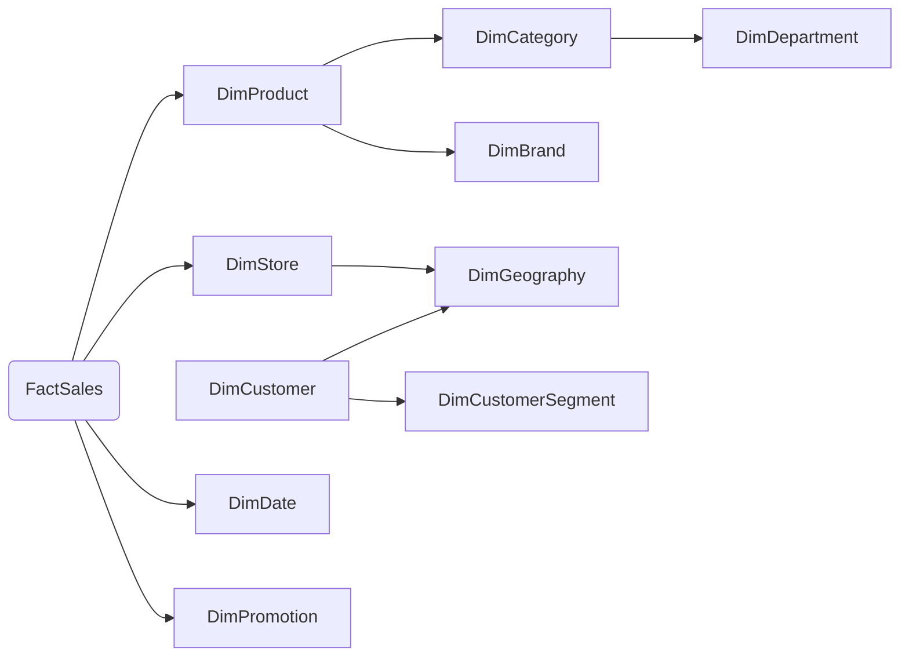

**MDX (Multi-dimension eExpress)** là dạng mở rộng của SQL, dùng để truy vấn trên dữ liệu đa chiều.

**Khác biệt lớn nhất so với SQL**:
- SQL trả về bảng 2 chiều (dòng x cột).
- MDX cho phép định nghĩa **nhiều trục (axis)** - `COLUMNS` (trục 0), `ROWS` (trục 1), `PAGES` (trục 2), `CHAPTERS`, `SECTIONS`,... (*dạng tổng quát là `AXIS(n)`*) phản ánh đúng bản chất đa chiều của cube.

# Ngữ pháp

### Cấu trúc tổng quát

```mdx
[
	WITH
	MEMBER
	SET...
]
SELECT [dim 1][dim 2]...
FROM [cube]
[WHERE [slice/dice]]
```

### Member

Một giá trị cụ thể trong một chiều, viết theo dạng `[Dimension].[Hierarchy].[Member]`.

```mdx
[Time].[Year].[2026]
[Product].[Category].[Drinks]
[Measures].[Revenue]
```

**Lưu ý**:
- Cú pháp này chỉ trỏ được đến member cần tìm. Để lấy được giá trị thật, cần dùng `.MEMBERS` phía sau cùng.
- Để lấy 1 thuộc tính định lượng trong fact, cần dùng cú pháp `[Measures].[AttributeName]...`.

### Tuple

Một tổ hợp của các member từ nhiều chiều khác nhau, đặt trong dấu ngoặc đơn `( )`.

```mdx
([Time].[Year].[2026], [Store].[City].[Hà Nội])
```

### Set

Một danh sách các member hoặc tuple, đặt trong dấu ngoặc nhọn `{ }`

```mdx
{[Time].[Quarter].[Q1], [Time].[Quarter].[Q2]}
```

### Function

| Hàm                                                        | Ý nghĩa                                                                                                                                                                         | VD                                                                                                                                       |
| ---------------------------------------------------------- | ------------------------------------------------------------------------------------------------------------------------------------------------------------------------------- | ---------------------------------------------------------------------------------------------------------------------------------------- |
| `CrossJoin(<Set1>, <Set2>)`                                | Tạo **tích Descartes** giữa 2 tập hợp. Có thể viết tắt bằng dấu `*`                                                                                                             | `CrossJoin([Product].[Category].MEMBERS, [Date].[Year].MEMBERS)`  <br>  <br>hoặc: `[Product].[Category].MEMBERS * [Date].[Year].MEMBERS` |
| `Filter(<Set>, <Condition>)`                               | **Thu gọn** một tập hợp, chỉ giữ lại các member thỏa mãn điều kiện logic cho trước. Trả về subset của tập ban đầu                                                               | `Filter([Product].[Product Name].MEMBERS, [Measures].[Sales Amount] > 100000000)` → chỉ lấy sản phẩm có doanh thu > 100 triệu            |
| `Order(<Set>, <Sort Key>, <ASC \| DESC \| BASC \| BDESC>)` | **Sắp xếp** các phần tử trong 1 tập hợp theo 1 giá trị (thường là measure). `ASC/DESC` giữ nguyên cấu trúc phân cấp; `BASC/BDESC` (Break) sắp xếp phẳng không theo cấu trúc cây | `Order([Product].[Product Name].MEMBERS, [Measures].[Sales Amount], DESC)` → sắp xếp sản phẩm theo doanh thu giảm dần                    |
| `TopCount(<Set>, <n>, <Sort Key>)`                         | Lấy **n phần tử đứng đầu** trong tập hợp, đã được sắp xếp giảm dần theo giá trị đo.                                                                                             | `TopCount([Product].[Product Name].MEMBERS, 10, [Measures].[Sales Amount])` → Top 10 sản phẩm bán chạy nhất                              |
| `ParallelPeriod(<Level>, <n>, <Member>)`                   | Trả về **member ở kỳ song song** - cùng vị trí tương đối nhưng lùi `n` bước ở cấp `Level` so với `Member` cho trước. Dùng phổ biến để so sánh **cùng kỳ năm/quý/tháng trước**   | `ParallelPeriod([Date].[Year], 1, [Date].[Month].&[3]&[2025])` → trả về tháng 3/2024 (lùi 1 năm so với tháng 3/2025)                     |
| `Sum(<Set>, <Numeric Expression>)`                         | Tính **tổng** giá trị của 1 biểu thức số (thường là measure) trên toàn bộ tập hợp cho trước                                                                                     | `Sum([Date].[Month].MEMBERS, [Measures].[Sales Amount])` → tổng doanh thu của tất cả các tháng                                           |
| `StrToMember(<String Expression>)`                         | Chuyển một **chuỗi ký tự (string)** thành 1 tham chiếu member thực sự trong MDX.                                                                                                | `StrToMember("[Date].[Year].&[2025]")` → tương đương viết trực tiếp `[Date].[Year].&[2025]` nhưng cho phép truyền chuỗi biến             |
| `IIf(<Condition>, <True Expr>, <False Expr>)`              | Hàm **điều kiện if-else**: nếu điều kiện đúng trả về biểu thức 1, sai trả về biểu thức 2.                                                                                       | `IIf([Measures].[Sales Amount] > 1000000, "Đạt KPI", "Chưa đạt")`                                                                        |
| `<Member>.Lag(<n>)`                                        | Trả về member nằm **lùi n vị trí** so với member hiện tại trong cùng level (cùng chiều). `Lag(1)` = `PrevMember`; `Lag(-1)` = `NextMember`                                      | `[Date].[Month].CurrentMember.Lag(1)` → tháng liền trước tháng hiện tại                                                                  |

**So sánh `WHERE` và `FILTER`**:
- `WHERE` - chỉ "cắt lớp" cube theo 1 member cố định, không so sánh giá trị, có vai trò ngữ cảnh tính toán và được thực hiện trước `FILTER` và có hiệu năng cao hơn.
```mdx
SELECT
	[Measures].[Sales Amount] ON COLUMNS,
	[Product].[Category].[Category].MEMBERS ON ROWS
FROM [SalesCube]
WHERE ( [Date].[Year].&[2025] )
```

- `FILTER()` - chọn ra những phần tử thỏa mãn điều kiện về **giá trị**.
```mdx
SELECT
  [Measures].[Sales Amount] ON COLUMNS,
  FILTER(
    [Product].[Category].[Category].MEMBERS,
    [Measures].[Sales Amount] > 500000000
  ) ON ROWS
FROM [SalesCube]
```

>[!note]
>Luôn ưu tiên đưa điều kiện *cố định 1 giá trị* vào `WHERE`. Chỉ dùng `FILTER()` khi thực sự cần so sánh theo giá trị đo (measure) hoặc điều kiện logic phức tạp.

# Ví dụ

Cho schema:

**Fact**: `FactSales`:

| Cột            | Kiểu    | Ghi chú        |
| -------------- | ------- | -------------- |
| DateKey        | FK      | → DimDate      |
| ProductKey     | FK      | → DimProduct   |
| StoreKey       | FK      | → DimStore     |
| CustomerKey    | FK      | → DimCustomer  |
| PromotionKey   | FK      | → DimPromotion |
| Quantity       | Measure | Số lượng bán   |
| SalesAmount    | Measure | Doanh thu      |
| CostAmount     | Measure | Giá vốn        |
| DiscountAmount | Measure | Giảm giá       |

**Dim**:
- `DimDate`: DateKey, FullDate, DayOfWeek, Month, MonthName, Quarter, Year
- `DimProduct`: ProductKey, ProductName, SKU, CategoryKey (FK), BrandKey (FK), UnitPrice
- `DimCategory`: CategoryKey, CategoryName, DepartmentKey (FK)
- `DimDepartment`: DepartmentKey, DepartmentName
- `DimBrand`: BrandKey, BrandName, Manufacturer
- `DimStore`: StoreKey, StoreName, StoreType, GeographyKey (FK)
- `DimGeography`: GeographyKey, City, Province, Region, Country
- `DimCustomer`: CustomerKey, CustomerName, Gender, BirthDate, SegmentKey (FK), GeographyKey (FK).
- `DimCustomerSegment`: SegmentKey, SegmentName.
- `DimPromotion`: PromotionKey, PromotionName, DiscountType, StartDate, EndDate.



**Doanh thu theo năm**:
```mdx
SELECT
	[Measures].[Sales Amount] ON COLUMNS,
	[Date].[Year].MEMBERS ON ROWS
FROM [SalesCube]
```

**Doanh thu theo nhãn hiệu, chỉ thống kê trên các record thuộc phân khúc `VIP` năm `2025`**
```mdx
SELECT
	[Measures].[Sales Amount] ON COLUMNS,
	[Product].[Brand].MEMBERS ON ROWS,
FROM [SalesCube]
WHERE (
	[Customer].[Segment].&[VIP],
	[Date].[Year].&[2025]
)
```

**Những sản phẩm có doanh thu trên 100 triệu**:
```mdx
SELECT
	[Measures].[Sales Amount] ON COLUMNS,
	FILTER(
		[Product].[Product Name].MEMBERS,
		[Measures].[Sales Amount] > 100000000
	) ON ROWS,
FROM [SalesCube]
```

**Top 10 sản phẩm bán chạy nhất**:
```mdx
SELECT
	[Measures].[Sales Amount] ON COLUMNS,
	TOPCOUNT(
		[Product].[Product Name].MEMBERS,
		10,
		[Measures].[Sales Amount]
	) ON ROWS,
FROM [SalesCube]
```

**So sánh doanh thu năm `2025` với cùng kỳ năm trước**:
```mdx
WITH
	MEMBER [Measures].[Sales LY] AS
	(
		PARALLELPERIOD(
			[Date].[Year],
			1,
			[Date].CurrentMember
		),
		[Measures].[Sales Amount]	
	)
	MEMBER [Measures].[YoY Growth %] AS
	(
		[Measures].[Sales Amount] - [Measures].[Sales LY]	
	) / [Measures].[Sales LY],
	FORMAT_STRING = 'Percent'

SELECT
	{
		[Measures].[Sales Amount],
		[Measures].[Sales LY],
		[Measures].[YoY Growth %]
	} ON COLUMNS,
	[Date].[Month].MEMBERS ON ROWS
FROM [SalesCube]
WHERE ([Date].[Year].&[2025])
```
